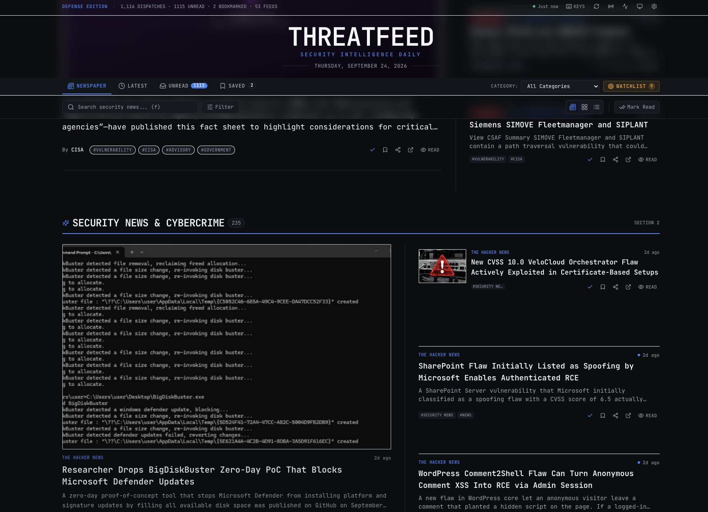

# ThreatFeed — Security Intelligence Daily

> **A polished, modern, client-side-only security news reader that aggregates RSS/Atom feeds and presents them as a beautiful digital newspaper.**

**🌐 Live site: [https://jozeta.github.io/ThreatFeed/](https://jozeta.github.io/ThreatFeed/)**

Inspired by the editorial elegance, typography, and usability of **Newsify for iOS**, ThreatFeed transforms security alerts, threat research, and exploit writeups into a high-end digital publication.



---

## 🗞️ Key Features

### 1. Editorial Newspaper Experience
- **Front Page Lead Hierarchy**: Bold hero stories with large editorial typography, supporting secondary features, and asymmetric news streams.
- **True Newspaper Layouts**: Flowing CSS grid and column rules rather than generic card grids or tables.
- **Multiple Layout Modes**: Switch smoothly between:
  - **Newspaper Mode**: Broadsheet editorial hierarchy.
  - **List + Thumbnails**: Modern media-rich newsfeed.
  - **Compact List**: Fast traditional scanner for rapid triage.
- **Latest Tab**: A strict newest-first stream, independent of the sort filter, in every layout: on Latest (and My Feed) the newspaper starts with sections and clustering off, and turning them on there leaves the front page unchanged.
- Long lists render incrementally with a **Show more** button, so large archives stay responsive.
- **Freshness Indicators**: Relative timestamps (`12m ago`, `2h ago`, `Yesterday`, `24 Sep`).
- **Editorial Fallbacks**: Never leaves ugly broken image icons; generates threat-themed gradients and branding placeholders.

### 2. Pure Client-Side Architecture (Zero Backend)
- **100% Client-Side**: No Node.js server, no Express, no API routes, no serverless functions. The only server-side work is a scheduled GitHub Actions job that builds a static feed snapshot (see [Feed Snapshot](#-feed-snapshot--cve-intelligence)).
- **Deploy Anywhere**: Deployable directly as a static bundle to **GitHub Pages**, **Cloudflare Pages**, **Netlify**, **Vercel Static**, or any static web server (NGINX/Apache/S3).
- **Offline Persistence**: Powered by browser **IndexedDB** (`idb`), storing articles, read/viewed/bookmarked states, custom tags, and feeds. Articles older than the configured maximum age, and articles from removed feeds, are cleaned up automatically; bookmarks are always kept.
- **PWA & Offline First**: Installable Progressive Web App with service worker caching the application shell for offline reading.

### 3. Established Security Feeds Configuration
Pre-configured with curated, verified security feeds organized by category:
- **Security News**: The Hacker News, Krebs on Security, SANS Internet Storm Center, BleepingComputer, SecurityWeek, Dark Reading, Help Net Security.
- **Vulnerabilities**: CISA Advisories and Alerts (KEV additions), Google Project Zero, PortSwigger Web Security Research, Exploit-DB, ZDI, MSRC; national CERTs (CERT/CC, CERT-SE, NCSC-NL, CERT-EU, Canadian Centre for Cyber Security, JPCERT/CC); vendor PSIRTs (Cisco, Fortinet, Palo Alto Networks); Ubuntu and Debian security notices, Chrome Releases, Wordfence and Horizon3.ai, NCSC UK, CISA ICS Advisories.
- **Threat Intelligence**: Cisco Talos, Microsoft Security, SentinelOne Labs, Securelist (Kaspersky), Sekoia.io, Group-IB, Proofpoint Threat Insight, Trend Micro Research, Bitdefender Labs, BushidoToken.
- **Malware Research**: Malwarebytes Labs, ESET WeLiveSecurity, Sophos X-Ops, Malware Traffic Analysis, Didier Stevens, Hexacorn, Emsisoft.
- **Red Team & Offensive Tradecraft**: SpecterOps, Bishop Fox.
- **Blue Team & Detection Engineering**: Huntress, Elastic Security Labs, Windows Incident Response, Inversecos, Invictus IR, AboutDFIR, DFIR Diva, Arctic Wolf Labs.
- **Cloud & Research**: Wiz, Datadog Security Labs, Sysdig, AWS Security Blog, Google Cloud Security Blog, Cloudflare Blog.
- **CISO & Leadership**: Resilient Cyber, tl;dr sec.
- **Platform Ecosystems**: The Keyword (Google), Google Workspace Updates, Android Developers Blog, Apple Newsroom, Apple Developer News, The Eclectic Light Company, Michael Tsai, Windows Blog.
- **Microsoft Admin & IT**: Office 365 for IT Pros, Practical 365, Born's Tech and Windows World, AskWoody, 4sysops, Petri IT Knowledgebase.
- **General Tech**: LWN.net, Phoronix, GitHub Blog, Kubernetes Blog, Hacker News front page.

### 4. Feed Management & OPML Interoperability
- Add custom RSS 2.0 or Atom XML feeds directly in the UI.
- Enable, disable, edit, and delete feeds.
- **OPML 2.0 Import & Export** for seamless migration between RSS readers.
- **Full JSON Backup & Restore** of all subscriptions, read state, bookmarks (including the full bookmarked articles, so they survive even after leaving their feed), and settings. Imported backups are validated and re-sanitized.
- Reset to default curated security feeds anytime with 1 click.

### 5. Client-Side CORS Handling & Feed Health Telemetry
- Transparent handling of browser cross-origin limitations with real-time health badges:
  - `Healthy ●`
  - `CORS Restriction ●`
  - `Invalid XML ●`
  - `Timeout ●`
  - `HTTP Error ●`
  - `Network Error ●`
  - `Proxy Can't Reach Site ●` (the proxy answered but couldn't connect to the feed's site, usually because the site blocks proxy servers)
- Configurable fetch modes in Settings. Each mode tries a chain of gateways, with a timeout per attempt, so a single dead proxy does not stall a refresh:
  - **CORSFix (`proxy.corsfix.com`)** (default): CORSFix → direct fetch → RSS2JSON
  - **RSS2JSON (`api.rss2json.com`)**: RSS2JSON → CORSFix → direct fetch
  - **AllOrigins (`api.allorigins.win`)**: AllOrigins → CORSFix → direct fetch → RSS2JSON (AllOrigins is currently unreliable, so saved AllOrigins settings are moved to CORSFix on load)
  - **Direct Browser Fetch (Strict Origin)**: only works for feeds that send `Access-Control-Allow-Origin` headers
  - **Custom User Proxy**: your own reverse proxy or Cloudflare Worker (use `%s` in the URL as a placeholder for the encoded feed URL, otherwise the feed URL is appended).
- Feeds are fetched by 6 concurrent workers, with progress shown during refresh.
- Optional auto-refresh (15 min to 3 h). A per-feed cooldown (default 1 h) skips feeds that were fetched successfully within that window; manual refresh always fetches everything.
- Requests to public proxies are paced and shared across all fetch workers: an HTTP 429 pauses that proxy for every worker (honouring `Retry-After`, otherwise exponential backoff with jitter) and the feed is retried up to 3 times.
- Articles appear while a refresh is still running (merged about once a second) instead of after the slowest feed.
- Individual retry buttons for every feed, plus a Feed Health page with per-gateway diagnostics and latency probes. Each feed shows when it was last updated and how (**GitHub Action** snapshot, a proxy, or a direct fetch), failed feeds show their last attempt and last success, and a status card shows how old the server snapshot is and when the next one is due.

### 6. Distraction-Free Article Reader
- Dedicated reading view with full typography controls.
- Displays source, date, author, hero image, and sanitized description.
- **"Read Original Article →"** primary action.
- Custom tag adder: add your own threat tags (e.g. `+APT28`, `+ZeroDay`, `+ActiveDirectory`) to any article.
- Integrated Web Share API and 1-click clipboard copy.

### 7. Instant Search, Combinable Filters & Sorting
- Client-side full-text search (MiniSearch) across titles, summaries, sources, tags, CVEs and authors: ranked, prefix-matching and typo-tolerant (`ransomwar atack` still finds ransomware attacks). Sort by **Relevance** while searching, and star a query to keep it as a **saved search**.
- **Mute rules**: muted keywords hide articles everywhere (bookmarks excepted), and whole categories can be left off the newspaper front page (Settings → Mute Rules).
- Unread counts per category in the category menu, and per feed on the Sources page.
- Combinable filters:
  - Category (Security News, Threat Intel, Vulnerabilities, Malware, Red Team, Blue Team, Research)
  - Source feed
  - Threat topic tags (`#Zero-Day`, `#Ransomware`, `#CVE`, `#Exploit`, `#APT`, etc.)
  - Reading state (`All`, `Unread`, `Read`)
  - Minimum severity (`Critical`, `High`, `Medium`, `Low`)
  - Watchlist matches only
  - Date ranges (`Today`, `Past 7 Days`, `Past 30 Days`)
  - Sorting (`Newest`, `Oldest`, `Recently Read`, `Recently Viewed`, `Severity`)

### 8. Customization & Genuine Dark Mode
- **Dark Mode Palette**: Genuine cybersecurity night palette (`#0b0d10`, `#11151a`, `#f5f7fa`, `#9ba3af`, `#252b33`).
- **Light Mode Palette**: Crisp print editorial aesthetic.
- **Custom Accents**: Crimson, Amber, Emerald, Cyber Cyan, Electric Blue, Violet, or custom hex picker.
- **Newspaper Customizer**: Spacing (compact, comfortable, spacious), borders (none, subtle, strong), image sizing, and typography scale.

### 9. Keyboard Navigation Shortcuts
- <kbd>r</kbd> : Refresh all enabled feeds
- <kbd>f</kbd> or <kbd>/</kbd> : Focus search input
- <kbd>j</kbd> / <kbd>k</kbd> : Navigate next / previous article
- <kbd>o</kbd> : Open original article at external source
- <kbd>m</kbd> : Toggle read / unread status
- <kbd>b</kbd> : Bookmark / unbookmark article
- <kbd>?</kbd> : Display keyboard shortcuts cheat sheet
- <kbd>Esc</kbd> : Dismiss reader view or modals

### 10. Printable Broadsheet Newspaper
- Built-in print stylesheet (`@media print`).
- Clicking **"Print Newspaper Edition"** removes all application chrome, buttons, and navigation, formatting the day's security reports into a real black-and-white physical newspaper layout with date and masthead.

### 11. Threat Intelligence Enrichment
Every article is enriched in the browser while its feed is parsed, and the results are stored with it:
- **CVE extraction** from the title, summary, and content.
- **Severity scoring** (0–100, mapped to `critical` / `high` / `medium` / `low` / `info`) based on active-exploitation keywords (zero-day, actively exploited, RCE, KEV, with extra weight when several appear together), exploit/APT indicators, CVE count, source authority, and category. Keywords are matched as whole words and only against the article's own title, summary, and publisher categories; a feed's own tags are shown as tags but never raise severity. Stored articles are re-scored on load, so rule changes apply straight away.
- **IOC extraction** in the reader: CVEs, MITRE ATT&CK technique IDs, MD5/SHA-1/SHA-256 hashes, and public IPv4 addresses (loopback and RFC 1918 private ranges are ignored).
- **Watchlist**: keywords you track are highlighted and can be filtered on. The default watchlist covers active exploitation and zero-days, critical CVE phrases (unauthenticated RCE, CVSS 9.8+), major ransomware groups, attack campaigns and actors, and frequently exploited products; cloud, identity and APT stacks can be added in Settings. Matching is whole-word and case-insensitive (`APT` does not match `adapt`) and only looks at the article's own title, summary, CVEs and your custom tags, so feed-wide tags can't trigger alerts.
- **Deduplication**: drops repeats by ID, normalized URL, and near-identical titles (>82% word overlap) published within 48 hours of each other, which catches syndicated copies across feeds.
- **Story clustering**: groups coverage of the same incident from different sources, either by a shared CVE or by strong title overlap within 4 days, so one story shows up once with its related coverage.
- **Exploitation data**: CVEs listed in CISA's Known Exploited Vulnerabilities catalog make an article critical; FIRST EPSS scores (the probability of exploitation within 30 days) add weight. CVE chips show a **KEV** marker and the EPSS percentage, and hovering one loads its CVSS score from NVD (cached).
- **Indicator export**: download a reader article's indicators as **CSV** or as a **STIX 2.1** bundle (indicators, vulnerabilities, ATT&CK techniques and a report object) for a SIEM or threat intel platform.

### 12. Intelligence Views
- **Daily Briefing** tab: the last 24 hours (or 3 / 7 days) in one page: critical and high severity stories, watchlist hits, stories about your stack, CVEs newly added to CISA KEV, **vulnerabilities in your stack** (new KEV entries, critical CVEs and GitHub advisories matching your My Stack products), ransomware leak-site activity by group, and trending entities. Copy or download it as Markdown.
- **Ransomware & Breaches** tab, built from structured data in the snapshot:
  - **Leak-site victims** from the [Ransomware.live](https://www.ransomware.live) API (90 days, accumulated across snapshot runs): a daily activity chart, filters by period, group, country, sector and text, quick chips for your own country and the Nordics, a "publicly reported" badge and filter for victims also named in press reports or breach notices, newly appeared and gone-quiet groups, top groups / sectors / countries, and a panel per group. The panel shows its profile, first-seen date and aliases, tactics and techniques with tools (Ransomware.live), its MITRE ATT&CK entry, the CVEs it is known to exploit (from its documented TTPs, CISA #StopRansomware advisories and news coverage, linked to the Vulns page), known ransom payments, victims and coverage in your feeds. Links go to Ransomware.live, never to the leak sites themselves.
  - **Groups**: every group in the collected history, sortable by activity (7 / 30 days), growth or first-seen date, with a 13-week trend line, what it targets most, leak-site status (sites online, as counts only) and which intel exists for it. The group panel adds rank, trend and change versus the previous 30 days, CISA #StopRansomware advisories, vendor tracking names and research write-ups from [Malpedia](https://malpedia.caad.fkie.fraunhofer.de).
  - **Public reports**: attacks reported in the press or in official breach notifications (Ransomware.live), claimed by a group or not, per week and by country, with links to the sources.
  - **Ransom payments**: payments traced to known ransomware wallets ([Ransomwhere](https://ransomwhe.re)), per year and per family. A floor, not a total.
  - **Data breaches** added to [Have I Been Pwned](https://haveibeenpwned.com) in the last 90 days, with account counts and exposed data types (high-risk types such as passwords and ID numbers highlighted).
  - **Incident news**: articles from your feeds that report ransomware attacks or data breaches, grouped by story (keyword-based, so the occasional round-up post slips in).
- **Vulns** tab (Vulnerabilities & KEV), built from `data/vulns.json`, which is only downloaded when a view needs it. Click any CVE for a panel with its KEV entry, description (fetched from NVD on demand), CVSS and attack vector in words, a 30-day EPSS trend (live from FIRST.org), CISA's SSVC rating, affected products, links to public exploit code, the ransomware groups known to use it, advisories and coverage in your feeds. On phones the lists switch to cards.
  - **Known exploited (KEV)**: the whole CISA catalog with additions per month (ransomware-linked highlighted), time from disclosure to KEV listing, CVSS scores and readable CWE names, public exploit code (Metasploit modules, Nuclei templates, GitHub proof-of-concepts), CISA's SSVC rating (exploitation, automatable), quick filters for public exploits, remote no-login/no-click bugs, automatable bugs and your stack (matched against NVD's affected products too), filters by period, vendor, product, weakness, CVSS band, minimum CVSS (slider) and text, stats (added, ransomware-linked, vendors, federal due dates in the next 14 days), clickable top vendors / products / CWEs / CVSS bands, and a **Patch first** shortlist. Vendors you don't run can be hidden in Settings → Vulnerability Vendor Filter.
  - **New CVEs**: every CVE NVD published in the last 14 days, per day by CVSS severity, with top CWEs and CNAs and a searchable list of the critical ones.
  - **Exploit prediction**: the CVEs with the highest FIRST EPSS scores, the ones not (yet) in KEV, and how the KEV catalog spreads across EPSS bands.
  - **Open source**: reviewed [GitHub Security Advisories](https://github.com/advisories) from the last 14 days by ecosystem, package and severity.
  - **Vulnerability news**: your feeds' coverage split into exploited-in-the-wild, vendor & CERT advisories, and other vulnerability reporting, grouped by story.
  - **Watching**: star a CVE in its panel (or add it by ID) to follow it. After each refresh ThreatFeed checks whether it was added to KEV, whether its EPSS jumped (live from FIRST.org) or whether new articles mention it; changes are highlighted until you mark them seen and, with the Watched CVEs rule's 🔔 on, send a desktop notification.
- **Patch Tuesday** tab: Microsoft's monthly security updates from the MSRC API (`msrc.json`), with counts by severity and product, exploited and publicly disclosed CVEs, and a month picker.
- **Entity links and panels**: vendors, ransomware groups, threat actors, malware and CVEs mentioned in article text look like plain text, underline on hover and open their panel (built from `entities.json`). Panels open from any page via `?actor=`, `?malware=`, `?group=`, `?vendor=`, `?cve=` or `?tag=`; open several and the newest sits on top, with Back or <kbd>Esc</kbd> peeling them off one at a time. Actor and malware panels (from `actors.json`) show aliases, targets, tooling and coverage in your feeds, with a mentions-over-time chart from `trends.json`. Old `#/actors?actor=` links redirect and open the panel.
- **Clickable tags**: every tag opens a panel with the matching articles and vulnerabilities and a 30-day chart.
- **Plots**: a vendor severity-over-time scatter in vendor panels, mentions-over-time charts for actors, malware, groups and vendors, and a severity x impact heatmap on Patch Tuesday.
- **Glass panels and motion**: side panels are clear blurred glass over a dimmed, blurred page; they slide in, then fade. Cards lift, tabs get a sliding underline, numbers count up and charts draw in. Everything animated switches off with Settings → Reduce motion or your system's reduced-motion setting.
- **Vendor pages**: click a vendor anywhere (or open `?vendor=Fortinet`) for a panel with a Wikipedia summary, stats and charts, KEV entries, new CVEs, news and advisories; Microsoft also gets Patch Tuesday tiles.
- **Keyword monitors**: Sources → Add Keyword Monitor follows a keyword or phrase through a Google News RSS feed.
- **IoC lookups**: the reader links indicators (IPs, domains, hashes) to lookup services.
- **Shareable links**: the page, tab, filters and open CVE live in the URL hash (e.g. `#/vulns/kev?kevVendor=Fortinet&min=9&cve=CVE-2026-1234`), so any view can be bookmarked or shared and the browser's Back button works inside the app. Adding `?vendor=Fortinet` opens that vendor's panel on any page.
- **Trending**: CVEs, ransomware groups, threat actors and frequently exploited products mentioned most this week compared with last week, with per-day sparklines. Shown on top of the newspaper and in the briefing; click one to search for it.
- **My Stack**: list the products you run (Settings → My Stack). Matching articles get a "Your stack" badge, rank higher within newspaper sections, and get their own briefing section.
- **My Feed and alert rules**: write your own News and Vulns rules in Settings → Alert Rules with an all/any condition builder, alongside the built-in Watchlist, My Stack (news and vulns) and Watched CVEs rules (fixed; enable them or turn on 🔔, or duplicate one as a custom rule). The **My Feed** tab lists everything that matches an enabled rule, with NEW tags; its News and Vulns sub-tabs can be linked directly as `#/feed/news` and `#/feed/vulns`. Each check sends at most one combined desktop notification, with a minimum gap of 1, 2, 3, 4, 6, 12 or 24 hours between notifications (default 1). Notifications only fire while a ThreatFeed tab is open; with several tabs open, one of them runs the checks. New CVEs below CVSS 7 only match when they are in KEV or mentioned in an article; public exploit data covers KEV and CVSS 7+ CVEs, EPSS covers KEV, CVSS 9+ and article-mentioned CVEs.

### 13. Sync & Resilience
- **Cross-device sync** through a private GitHub Gist (Settings → Cross-Device Sync). Per-article state is merged by whichever device changed it last; feeds, bookmarked articles, keyword lists and alert rules are combined (the newer edit of a rule wins; a rule deleted on one device comes back from the other). The token is stored only in that browser's IndexedDB and is never included in backups or synced data.
- **Failing-feed backoff**: a feed that fails 5 refreshes in a row is only retried hourly during automatic refreshes (manual refresh still tries it).

### 14. TV & Dashboard Modes
- **TV mode**: a full-screen wall of 5–6 large news tiles (a 3×2 grid of 1×1 and 2×1 tiles) that rotates through the top stories. It is available on the front page / Latest, Briefing and Ransomware pages; Ransomware mixes in leak-site victim tiles, about one in three. Enter it with the **TV** button next to the layout buttons. Leave with the × in the top-right corner (it hides after 3 seconds without mouse movement), <kbd>Esc</kbd>, or by leaving browser full screen. The screen is kept awake (Wake Lock) where supported. If fewer than 5 stories are newer than 24 hours, the window widens to 72 hours, then 7 days.
- **Dashboard mode**: a figures-first view for screens. **Vulns** shows critical CVEs and CISA KEV additions over 7 days, public exploits over 7 days, the latest Patch Tuesday, "Exploited right now" and a 90-day weekly trend. **Ransomware** shows victims over 24 hours and 7 days, active groups, the most-hit sector, top groups, victims per day, top countries and the latest victims. Open it with the **Dashboard** button on those pages.
- **Kiosk URLs** (prefix with `https://jozeta.github.io/ThreatFeed/`):
  - `#/latest?tv=1`, `#/briefing?tv=1`, `#/ransomware?tv=1`: TV mode
  - `#/vulns?dash=1`, `#/ransomware?dash=1`: dashboard mode

  A URL opened directly may not reach true full screen without a click, so for a dedicated display use the browser's kiosk mode or F11.
- **Settings → TV & dashboard**: rotation interval of 1–30 minutes (default 2), and transition **Fade**, **Slide** or **Reveal** (default Reveal). Reduce motion forces a plain fade.
- **Trend history**: dashboard trends are built from `stats.json` (see [Feed Snapshot](#-feed-snapshot--cve-intelligence)), so they fill in over the coming weeks. "vs last week" figures stay hidden until there is history to compare against.

---

## 🛠️ Technology Stack

- **Framework**: React 18 + TypeScript
- **Bundler**: Vite
- **Styling**: Tailwind CSS + Custom CSS Variables + Print Media Queries
- **Typography**: Newsreader (Editorial Serif) + Inter (Sans-Serif UI) + JetBrains Mono (Code/Threat Indicators)
- **Local Persistence**: IndexedDB via `idb`
- **Security & Sanitization**: DOMPurify
- **Icons**: Lucide React
- **Search**: MiniSearch
- **Tests**: Vitest + jsdom

---

## 🚀 Running Locally

```bash
# Install dependencies
npm install

# Start development server
npm run dev

# Build production static website (dist/)
npm run build

# Preview static build
npm run preview

# Run the test suite
npm test

# Build public/data/snapshot.json locally (all default feeds + KEV/EPSS data)
npm run snapshot
```

Without a local snapshot, the dev server falls back to fetching feeds live through the configured CORS gateway.

---

## 📦 Feed Snapshot & CVE Intelligence

`.github/workflows/deploy.yml` runs every 30 minutes (and on every push to `main`): it runs the tests, then `npm run snapshot`, then builds and deploys. The snapshot script (`scripts/build-snapshot.ts`) fetches every enabled default feed server-side (where CORS doesn't apply), parses them with the app's own parser, and adds CISA KEV and FIRST EPSS data for every CVE mentioned, the full KEV catalog, the last 14 days of CVEs from NVD and reviewed GitHub advisories, the top EPSS scores, plus ransomware leak-site victims (Ransomware.live) and recent breaches (Have I Been Pwned). The results ship with the site:

- `data/snapshot.json` (about 1.9 MB compressed): articles, feed health, CVE intel for the articles, incidents, and the status of every external source (shown in Feed Health → "Data sources in the last snapshot").
- `data/vulns.json` (about 160 KB compressed): KEV catalog with CVSS and EPSS, NVD statistics and critical CVEs, a compact `watchable` list of CVSS 7–8.9 CVEs from the last 14 days, GitHub advisories, top EPSS. Loaded only by the views that use it, or when an enabled Vulns alert rule (or a watched CVE) needs it.
- `data/ransomware.json` (about 30 KB compressed): per-group profiles (techniques, tools, ATT&CK, linked CVEs, payments), publicly reported attacks and Ransomwhere payment totals. Loaded only by the Ransomware page. Ransomware.live allows one request a minute, so each run makes at most four (the latest victims and reports every run, the group list with every group's profile daily, this month's victims every six hours) and carries the rest over; MITRE ATT&CK, Malpedia and Ransomwhere are refreshed daily. Exploit data (Metasploit's module list, Nuclei's template index, PoC-in-GitHub) is fetched every run and reduced to the CVEs the app shows; CWE names come from `scripts/data/cwe-names.json` (MITRE CWE 5.0).
- `data/nvd-cache.json`: every CVE in the 14-day NVD window plus KEV CVSS scores, read back by the next run (`PREVIOUS_NVD_CACHE_URL`) so it only asks NVD for CVEs modified since, usually one small request instead of about 40 MB. Older than two days or missing, the script downloads the window again.
- `data/msrc.json`, `data/actors.json`: Patch Tuesday releases and actor/malware profiles (used by the actor and malware panels). Each run reads its previous copy (`PREVIOUS_MSRC_URL`, `PREVIOUS_ACTORS_URL`) and carries over what it can't refetch.
- `data/entities.json`: the names (vendors, ransomware groups, actors, malware, aliases) the app turns into entity links.
- `data/trends.json`: daily counts kept for 730 days; the mentions-over-time charts in the panels read it. The run recounts the last three days on top of the previous copy (`PREVIOUS_TRENDS_URL`, or `PREVIOUS_TRENDS_FILE` from an `actions/cache` copy). A deploy replaces the whole site, so a "Keep the trends history" step restores the published or cached copy if the snapshot didn't write one; the history is never lost.
- `data/stats.json`: daily counts for the last 400 days (critical and high CVEs, KEV additions, public exploits, leak-site victims, and per group, country and sector), de-duplicated by CVE and victim ID. Like `trends.json`, it is read back on the next run and kept across deploys, and it feeds the TV and dashboard modes.

**Optional NVD API key**: NVD allows 5 requests per 30 seconds without a key and 50 with one. Request a free key at <https://nvd.nist.gov/developers/request-an-api-key>, then add it as a repository secret named `NVD_API_KEY` (Settings → Secrets and variables → Actions). The workflow passes it to the script; without it everything still works, just slower on full downloads.

In the browser (Settings → Data Source, on by default), the app loads the snapshot on startup and on each refresh, and only fetches live the feeds it doesn't cover: the ones you added yourself, plus any default feed the snapshot failed to fetch (some sites block GitHub's servers but still answer the proxy). With 120 default feeds this replaces a multi-minute proxied refresh with a few seconds, and avoids the public proxies' blocking and rate limits entirely. A failed snapshot step doesn't block a deploy; the app then falls back to live fetching.

`.github/workflows/ci.yml` runs the tests and a build for pull requests and other branches.

---

## 🌐 Static Deployment

ThreatFeed produces completely static HTML, CSS, and JavaScript files in `dist/`.

### Deploy to Cloudflare Pages / Netlify / Vercel
- Build command: `npm run build`
- Output directory: `dist`

### Deploy to GitHub Pages
Simply publish the contents of the `dist/` directory to your `gh-pages` branch.
